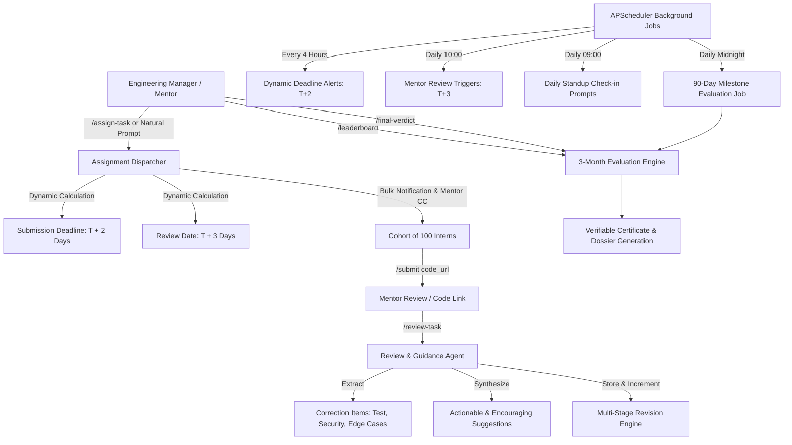

# InternOps AI

**Autonomous Operations, Task Dispatching & AI Guidance Architecture for Engineering Internships**

InternOps AI orchestrates and automates a structured **3-month (90-day) engineering internship program** for cohorts of **100 interns**. It functions as an **Assignment Dispatcher**, **Review & Guidance Agent**, and **Milestone Evaluator** exposed over a conversational chatbot command surface.

---

## 🏗️ Core Architecture & Capabilities



### 1. ⚡ Assignment Dispatcher
- **Prompted by Manager**: Handles `/assign-task cohort=1 title="..." spec="..."` or conversational prompts like:
  ```
  Assign Task 1 to Cohort 1: spec="Build a RESTful Authentication service with JWT tokens and 85%+ test coverage"
  ```
- **Dynamic Timetable**:
  - Automatically calculates submission deadline: $T + 2\text{ days}$ (at 23:59 UTC).
  - Automatically marks mentor review date: $T + 3\text{ days}$.
- **Mass Dispatch**: Instantly enqueues and dispatches formatted notification emails with specs, instructions, and mentor CC to all 100 interns in the cohort.

### 2. 🤖 Review & Guidance Agent
- **Invoked via**: `/review-task intern_id=<id> task_id=<id> [code="<url>"] notes="<mentor observations>" [score=<0-100>]`
- **Correction Extraction**: Analyzes mentor notes and code submissions to extract concrete, structured action items (Unit Testing, Security Hardening, Defensive Engineering, Code Quality, Documentation).
- **Actionable & Encouraging Guidance**: Synthesizes supportive, growth-oriented feedback and specifies exact instructions for the next iteration.
- **Multi-Stage Revision Tracking**:
  - Increments revision cycles (`revision_number`: 1, 2, 3...).
  - Updates assignment state (`revision_requested` vs `approved`).
  - Stores complete audit history in `task_revisions`.
  - Dispatches feedback report directly to the intern.

### 3. 📜 3-Month Milestone & Evaluation Engine
- **Horizon**: Evaluates interns across the 90-day internship lifecycle.
- **Aggregate Performance Metrics**:
  - **Task Completion Rate**: Percentage of assigned tasks approved.
  - **Average Code Score**: Cumulative average score across tasks.
  - **Revision Efficiency**: Responsiveness to feedback and rate of resolution across multi-stage revisions.
  - **Standup Consistency**: Percentage of daily standup check-ins logged.
  - **Composite Score Formula**:
    $$\text{Composite} = 0.40 \times \text{AvgScore} + 0.30 \times \text{CompletionRate} + 0.15 \times \text{RevisionEfficiency} + 0.15 \times \text{StandupRate}$$
- **Verdicts & Cryptographic Certificate ID**:
  - 🏆 **Passed with Honors — Full-Time Offer Recommended** ($\ge 90$)
  - 🎓 **Certified — Software Engineering Intern Graduate** ($\ge 75$)
  - 📋 **Certificate of Completion — Proficient with Growth Scope** ($60 - 74$)
  - ⚠️ **Conditional — Extended Mentorship Required** ($< 60$)
  - Generates verifiable certificate ID: `IOPS-2026-C{cohort_id}-{intern_id:03d}-{hash}`.

### 4. 💬 Chatbot Command Surface
Interactive webhook endpoint (`POST /chat`) accessible via Web UI, Slack, CLI, and email.

| Command | Example Syntax | Description |
|---|---|---|
| `/assign-task` | `/assign-task cohort=1 title="REST API" spec="CRUD with tests"` | Bulk-assigns task, sets $T+2$ deadline and $T+3$ review date, dispatches emails. |
| `/review-task` | `/review-task intern_id=1 task_id=1 code="https://github.com/..." notes="Add error handling"` | Extracts corrections, generates actionable guidance, tracks revision round. |
| `/leaderboard` | `/leaderboard [cohort=1] [limit=10]` | Displays real-time ranking, composite scores, revisions, and tier badges. |
| `/final-verdict` | `/final-verdict intern_id=1` | Evaluates 90-day milestone, issues official verdict & verifiable certificate ID. |
| `/submit` | `/submit task_id=1 url="https://github.com/..." notes="Ready for review"` | Intern submission or revision. |
| `/checkin` | `/checkin update="Completed JWT middleware" blockers="None"` | Daily standup log. |
| `/status` | `/status [cohort=1]` | View cohort task completion summaries. |
| `/interns` | `/interns [cohort=1]` | Directory of interns and assigned mentors. |
| `/help` | `/help` | Complete command guide. |

---

## 🗄️ Database Schemas (`schema.sql`)

PostgreSQL & SQLite compatible schema supporting cohorts, tasks, multi-stage revisions, check-ins, and milestone evaluations:

```sql
CREATE TABLE IF NOT EXISTS cohorts (
    id SERIAL PRIMARY KEY,
    name VARCHAR(255) NOT NULL,
    start_date DATE NOT NULL,
    end_date DATE,
    status VARCHAR(50) DEFAULT 'active',
    created_at TIMESTAMP DEFAULT CURRENT_TIMESTAMP
);

CREATE TABLE IF NOT EXISTS interns (
    id SERIAL PRIMARY KEY,
    cohort_id INTEGER NOT NULL REFERENCES cohorts(id) ON DELETE CASCADE,
    full_name VARCHAR(255) NOT NULL,
    email VARCHAR(255) NOT NULL UNIQUE,
    mentor_email VARCHAR(255) NOT NULL,
    status VARCHAR(50) DEFAULT 'active',
    enrolled_at DATE DEFAULT CURRENT_DATE,
    created_at TIMESTAMP DEFAULT CURRENT_TIMESTAMP
);

CREATE TABLE IF NOT EXISTS tasks (
    id SERIAL PRIMARY KEY,
    cohort_id INTEGER NOT NULL REFERENCES cohorts(id) ON DELETE CASCADE,
    title VARCHAR(255) NOT NULL,
    spec TEXT NOT NULL,
    due_date DATE,           -- Dynamic deadline: T + 2 days
    review_date DATE,        -- Marked review date: T + 3 days
    assigned_by VARCHAR(255) DEFAULT 'manager@example.com',
    created_at TIMESTAMP DEFAULT CURRENT_TIMESTAMP
);

CREATE TABLE IF NOT EXISTS intern_tasks (
    id SERIAL PRIMARY KEY,
    task_id INTEGER NOT NULL REFERENCES tasks(id) ON DELETE CASCADE,
    intern_id INTEGER NOT NULL REFERENCES interns(id) ON DELETE CASCADE,
    status VARCHAR(50) DEFAULT 'assigned', -- assigned, submitted, revision_requested, reviewed, approved
    submission_url TEXT,
    submission_notes TEXT,
    feedback TEXT,
    score INTEGER,
    revision_count INTEGER DEFAULT 0,
    due_date DATE,
    review_date DATE,
    submitted_at TIMESTAMP,
    reviewed_at TIMESTAMP,
    created_at TIMESTAMP DEFAULT CURRENT_TIMESTAMP,
    CONSTRAINT uq_task_intern UNIQUE (task_id, intern_id)
);

CREATE TABLE IF NOT EXISTS task_revisions (
    id SERIAL PRIMARY KEY,
    intern_task_id INTEGER REFERENCES intern_tasks(id) ON DELETE CASCADE,
    task_id INTEGER NOT NULL REFERENCES tasks(id) ON DELETE CASCADE,
    intern_id INTEGER NOT NULL REFERENCES interns(id) ON DELETE CASCADE,
    revision_number INTEGER NOT NULL DEFAULT 1,
    submission_url TEXT,
    mentor_notes TEXT,
    extracted_corrections TEXT,
    ai_guidance TEXT,
    score INTEGER,
    status VARCHAR(50) DEFAULT 'revision_requested',
    created_at TIMESTAMP DEFAULT CURRENT_TIMESTAMP
);

CREATE TABLE IF NOT EXISTS milestone_evaluations (
    id SERIAL PRIMARY KEY,
    intern_id INTEGER NOT NULL REFERENCES interns(id) ON DELETE CASCADE,
    cohort_id INTEGER NOT NULL REFERENCES cohorts(id) ON DELETE CASCADE,
    milestone_day INTEGER DEFAULT 90,
    completion_rate FLOAT NOT NULL,
    avg_score FLOAT NOT NULL,
    revision_efficiency FLOAT NOT NULL,
    standup_rate FLOAT NOT NULL,
    composite_score FLOAT NOT NULL,
    verdict VARCHAR(100) NOT NULL,
    certificate_id VARCHAR(100) UNIQUE NOT NULL,
    dossier_text TEXT NOT NULL,
    created_at TIMESTAMP DEFAULT CURRENT_TIMESTAMP
);
```

---

## ⏰ Automated APScheduler Jobs (`app/scheduler.py`)

InternOps AI schedules 4 automated background jobs:

1. **Daily Standup Prompts (`daily_standup_prompt_job`)**:
   - Schedule: Daily at 09:00 UTC.
   - Dispatches check-in prompt to all active interns to submit standup updates and blockers.
2. **Dynamic Deadline Alerts (`dynamic_deadline_alert_job`)**:
   - Schedule: Runs every 4 hours.
   - Scans for assignments approaching or on their dynamic $T+2$ deadline with pending submissions and alerts interns with mentor CC.
3. **Mentor Review Date Monitor (`mentor_review_date_job`)**:
   - Schedule: Daily at 10:00 UTC.
   - Alerts mentors on $T+3$ review date for tasks submitted and waiting for evaluation.
4. **90-Day Milestone Evaluation Trigger (`milestone_evaluation_90day_job`)**:
   - Schedule: Daily at 00:30 UTC.
   - Detects interns completing their 90-day milestone, automatically computes aggregate performance metrics, generates verified certification verdicts, and distributes dossiers.

---

## 🚀 Quickstart Guide

### 1. Seed Cohort & Interns
Seeds Cohort 1 with 100 interns, mentors, dynamic deadlines, assignments, sample revisions, and check-ins:
```powershell
python seed.py
```

### 2. Run Comprehensive Workflow Verification
Executes all commands and workflows programmatically:
```powershell
python test_workflow.py
```

### 3. Launch Web Console Server
```powershell
uvicorn app.main:app --reload
```
Navigate to **http://localhost:8000** to interact with the visual operations terminal, inspect real-time cohort statistics, and trigger slash commands with one-click quick actions!
